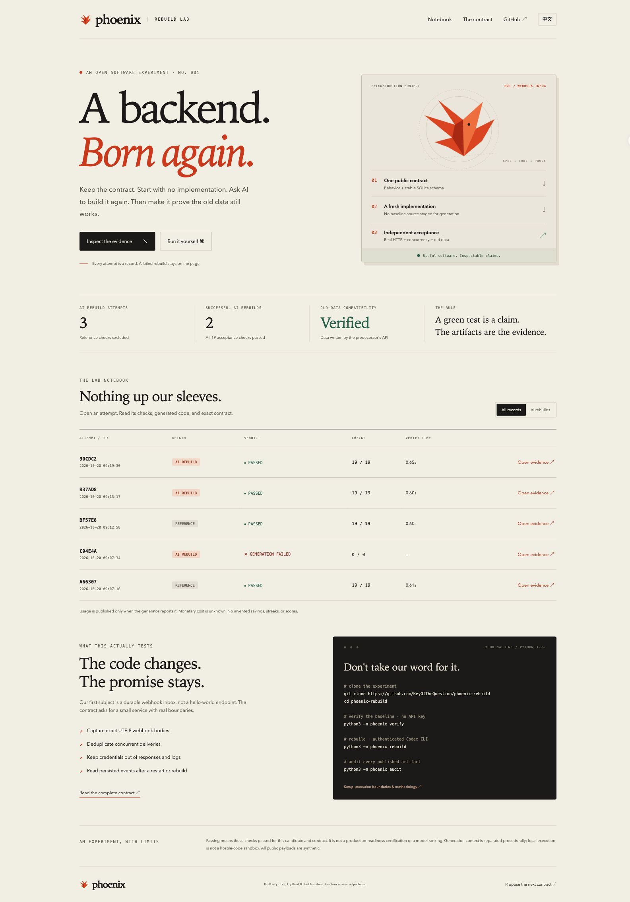

<p align="center"></p>

<h1 align="center">Phoenix</h1>

<p align="center"><strong>A backend. Born again.</strong><br>Same contract. Fresh code. Old data. Public evidence.</p>

<p align="center"><a href="https://keyofthequestion.github.io/phoenix-rebuild/">Experiment notebook</a> · <a href="README.zh-CN.md">中文</a> · <a href="specs/webhook-inbox.md">The contract</a> · <a href="docs/methodology.md">Methodology</a></p>

[](https://github.com/KeyOfTheQuestion/phoenix-rebuild/actions/workflows/ci.yml)
[](LICENSE)
[](pyproject.toml)

**Can AI rebuild the same useful backend from its written contract—and still read the previous implementation's data?**

Phoenix is an open, executable experiment. A generator receives a public specification in a fresh directory, produces a complete implementation, and faces an independent HTTP acceptance harness. Every published attempt includes its source, exact contract, outcome, artifact hashes, and reported usage. Failed attempts stay visible.

The first subject is a **durable webhook inbox**: capture exact UTF-8 bodies, authenticate inspection routes, deduplicate concurrent deliveries, preserve credentials, and reopen an existing SQLite database. Contract 001 has 19 acceptance checks; contract 002 adds migration and retention for 32 checks. There is a runnable, human-reviewed reference implementation; reference checks are labeled separately from AI rebuilds.

## Try it in a minute

Python 3.9+ and Git. No runtime dependencies or API key needed to verify the reference.

```sh
git clone https://github.com/KeyOfTheQuestion/phoenix-rebuild.git
cd phoenix-rebuild
python3 -m phoenix verify
python3 -m phoenix audit
python3 -m phoenix serve
# open http://127.0.0.1:8788
```

## Rebuild it for real

Install and authenticate the [Codex CLI](https://developers.openai.com/codex/cli/), then:

```sh
python3 -m phoenix rebuild --attempts 2 --timeout 300
# To check compatibility with a specific trusted earlier AI implementation:
python3 -m phoenix rebuild --predecessor docs/evidence/RUN_ID/server.py
# Optional: keep generation on the host CLI, then verify the result in Docker:
python3 -m phoenix rebuild --container --verification-timeout 90
```

The adapter makes actual model calls using your CLI authentication and usage allowance. It starts with a clean CLI configuration, preserves authentication, stages **no reference source or verifier**, and requests a structured, complete Python program. Each candidate gets a new directory; retries receive only failure summaries, not the previous source. Supply `--model <available-model>` to select a model or `--use-user-config` to opt into your personal CLI configuration.

Generation never deletes repository code. Only disposable temporary directories are discarded. Evidence is saved under `docs/evidence/` before cleanup. Rebuild and replay without `--container` run candidates as local child processes with a minimal environment; this is **not an adversarial-code sandbox**. See [execution boundaries](docs/setup.md) before evaluating code you do not trust.

## Inspect the proof

```text
specs/webhook-inbox.md          the implementation contract
examples/reference/server.py   the useful reference service
phoenix/verify.py              independent HTTP acceptance harness
phoenix/rebuild.py             actual Codex CLI generation adapter
docs/runs.json                public attempt ledger
docs/evidence/<run>/           code, contract, checks, provenance, hashes
```

For current records, the verifier first starts the previous implementation, creates an inbox and event **through real HTTP**, stops it, then starts the candidate against the same database. A successful compatibility check means the old event and its idempotency state survived. Early records explicitly use a verifier-created schema fixture instead; inspect `compatibility_fixture` or the archived verifier.

```sh
python3 -m phoenix replay <published-run-id>
python3 -m phoenix replay <published-run-id> --container --timeout 90
python3 -m phoenix verify --candidate path/to/trusted/server.py
```

Replaying first checks the ledger, manifest and artifact hashes, then runs a temporary copy of the verified candidate, verifier and predecessor (when recorded). It refuses inconsistent bundles and generation failures with exit code 2, before loading archived code, and does not write into the evidence directory. It does not regenerate code or charge model usage. See the [replay integrity repair and verification](docs/maintenance/2026-10-21-replay-integrity.md).

Passing is evidence for these checks and this contract—not production certification, model superiority, or guaranteed correctness. Artifact hashes detect inconsistent files; they are not an independent signature. USD cost is unknown and is never estimated from invented prices.

## Verify inside an optional container

With a Linux cgroup-v2 Docker engine, `python3 -m phoenix container-verify` runs the same HTTP checks in a disposable container with external networking disabled, a read-only root/input mount, no host credentials forwarded, and explicit CPU, memory and PID limits. An actual boundary probe must confirm the profile before a report is accepted. The image is pinned by digest, and an unavailable runtime produces an error without host fallback.

`container-verify` uses the current harness. For an archived experiment, `replay RUN_ID --container` checks the bundle first and sends the exact verified candidate, archived verifier and recorded predecessor bytes to Docker, without loading that verifier on the host. Early records retain their original SQL fixture when no predecessor was recorded. These verification commands do not rewrite historical outcomes or call a model.

`rebuild --container` makes a real model call through the host CLI, then verifies the generated source using verifier/predecessor snapshots frozen before generation. Docker and the pinned image are checked before any model call. A later runtime failure preserves the generated code as `verification-error`, with no acceptance verdict, host fallback or generation retry; exit code 2 distinguishes this from an acceptance failure. `--timeout` still limits generation; `--verification-timeout` separately limits container execution. The default remains local, and the scheduled reconstruction on this host remains local because Docker is unavailable here.

See the [container profile, limits and setup](docs/container-runner.md) and [2026-10-26 container rebuild verification record](docs/maintenance/2026-10-26-container-rebuild.md).

## Rebuild with retention and v1 migration

[Contract 002](specs/webhook-inbox-retention.md) adds per-inbox retention, explicit batches of at most 100 expired-event deletions, and atomic migration from v1. Existing events, tokens and idempotency survive migration; retention starts disabled. The AI-assisted [reference pilot](examples/retention/server.py) keeps the original tables and adds a policy table. Policy updates and reads never delete events implicitly.

```sh
python3 -m phoenix verify-retention
python3 -m phoenix verify-retention --full
python3 -m phoenix verify-retention --full --publish
# Exercise migration from a trusted archived v1 AI implementation:
python3 -m phoenix verify-retention --predecessor docs/evidence/RUN_ID/server.py
# Generate contract 002 with all 32 checks; choose a successful v1 AI predecessor:
python3 -m phoenix rebuild --contract 002 --attempts 2 --timeout 300 \
  --predecessor docs/evidence/20261103T023452Z-4ec8a9/server.py
# Optional: preflight Docker, then verify the generated v2 implementation there:
python3 -m phoenix rebuild --contract 002 --container --verification-timeout 90 \
  --predecessor docs/evidence/20261103T023452Z-4ec8a9/server.py
```

The default 13-check pilot uses real predecessor HTTP data and checks migration, policy persistence, bounded/concurrent expiry, isolation and key reuse. It explicitly backdates only synthetic v2 fixture events through SQLite after migration checks, rather than claiming that time actually elapsed.

`--full` adds the 19 baseline HTTP checks with an explicit schema-version-2 health expectation, giving 32 distinct checks. Both phases use candidate/predecessor bytes captured once, with separate fixture databases. Reports retain each phase and reject incomplete passing results or changed source bindings. The v1 baseline still defaults to schema version 1 and its original 19 check IDs; the verifier source change is disclosed in the [2026-10-28 verification record and negative control](docs/maintenance/2026-10-28-retention-composed.md).

Without `--publish`, these commands only print results. `--full --publish` captures the candidate, predecessor, contract, entrypoint and all four project-module dependencies before evaluation, then publishes those same bytes as a **contract-002 reference verification**. `python3 -m phoenix replay RUN_ID` validates the complete bundle and runs its frozen modules in a temporary private package. It does not import the current workspace verifier or modify the archive. Add `--container --timeout 90` to replay the complete verified package inside the same restricted Docker profile. The host checks all eight source/contract hashes, the 32-check result and the actual boundary probe; missing Docker or invalid output exits 2 without host fallback. See the [2026-10-30 container replay checks](docs/maintenance/2026-10-30-retention-container.md).

`rebuild --contract 002` now makes a real model call and uses the full frozen 32-check package. It publishes the exact prompt and all dependencies under the distinct `retention-ai-v1` profile. Reference checks call no model and retain `retention-composed-v1`; they stay outside AI metrics. Default generation remains contract 001. The audit enforces each profile's kind, complete artifacts, bindings and check set; historical records remain unchanged.

`rebuild --contract 002 --container` now preflights Docker before provider use, then runs the complete frozen AI verifier package there after generation. No archived verifier code is loaded on the host in this mode. A later container/runtime report error preserves all ten artifacts as a zero-check `verification-error` and stops without host fallback or another model call. Default acceptance remains local; completed AI archives also support local, Docker and installed-runtime matrix replay. See the [container-generation integration and verification](docs/maintenance/2026-11-05-retention-container-rebuild.md).

The 32-check migration fixture still requires a v1 predecessor. A separate eight-check fixture now checks v2-to-v2 policy/data continuity; it does not change the reconstruction verdict or add an AI attempt. Generation failures retain complete zero-check bundles. The [first real 32/32 AI reconstruction and two-runtime replay](docs/maintenance/2026-11-04-retention-ai.md) remains unchanged, including its original method limits.

```sh
python3 -m phoenix verify-continuity --candidate path/to/trusted/v2.py \
  --predecessor path/to/trusted/previous-v2.py --output-dir path/to/new-continuity-bundle
python3 -m phoenix replay-continuity path/to/new-continuity-bundle
```

The continuity fixture starts a v2 predecessor through HTTP, then checks enabled, explicitly disabled and longer retention policies, event bodies/headers/timestamps, tokens and idempotency across handoff and restart, bounded explicit expiry and expired-key reuse. Only synthetic fixture timestamps are backdated through SQLite while stopped; this is not elapsed-time evidence. Both commands run trusted code locally and make no model call. `--output-dir` optionally saves five frozen inputs (candidate, predecessor, contract, verifier and HTTP helper), the report and manifest in a new directory, outside the AI ledger. Replay validates hashes, kind/profile and source bindings before executing temporary copies. See the [fixture, evidence and limits](docs/maintenance/2026-11-06-v2-continuity.md).

Runtime matters: the October 30 AI candidate passed 19/19 on Python 3.14, but an additional replay on Python 3.9 failed 2 checks because of empty-query parsing. Both observations and the unedited candidate remain public in the [cross-runtime failure record](docs/maintenance/2026-10-30-retention-container.md#cross-runtime-failure-discovered-by-ci). A passing archived observation does not establish compatibility with every supported Python version.

New acceptance and replay results include `execution_runtime`: the measured Python implementation/version and SQLite library version. The notebook shows these versions or explicitly says “Not recorded” for older reports. Replay measures its own execution runtime and keeps the original report unchanged. To exercise the Python floor, run the whole command with an installed Python 3.9 interpreter, for example `python3.9 -m phoenix rebuild --attempts 2 --timeout 300`. The candidate and predecessor use that same interpreter; the Codex CLI's default model policy is unchanged. See the [runtime evidence and scope](docs/maintenance/2026-11-02-runtime-evidence.md).

To compare the same frozen archive across installed Python runtimes on POSIX:

```sh
python3 -m phoenix replay-matrix RUN_ID --python python3.9 --python python3.14 --timeout 30
```

The command audits once and supplies identical captured bytes to each runtime. It supports 1..4 explicit executables, a 1..300-second deadline per runtime and process-group cleanup on timeout. It returns each measured runtime and fresh acceptance report, preserves failures, and never installs Python, calls a model or publishes another ledger entry. Exit 0 means every invocation passed, 1 means acceptance failed, and 2 means refusal or a runtime/report error. Missing executables have no fallback. This is local trusted-code execution, not a hostile-code sandbox or an exhaustive compatibility claim. See the [matrix verification and negative control](docs/maintenance/2026-11-03-runtime-matrix.md).

## Run the webhook inbox


```sh
export PHOENIX_ADMIN_TOKEN="$(python3 -c 'import secrets; print(secrets.token_urlsafe(32))')"
python3 examples/reference/server.py
```

In another terminal (using the same admin token):

```sh
curl -s http://127.0.0.1:8787/health
curl -s http://127.0.0.1:8787/api/inboxes \
  -H "Authorization: Bearer $PHOENIX_ADMIN_TOKEN" \
  -H 'Content-Type: application/json' -d '{"name":"My local inbox"}'
# Keep the returned id and token. Tokens are shown only at creation.
curl -s "http://127.0.0.1:8787/hooks/INBOX_ID/INBOX_TOKEN" \
  -H 'X-Webhook-Id: example-001' -d '{"event":"hello.phoenix"}'
```

This is a local development service with a separate loopback delivery client.
Outbound delivery to other hosts and a durable outbox remain future work.

## Deliver an event locally

The [loopback delivery pilot](docs/delivery.md) can read a stored event and send
its exact UTF-8 body to an explicit local HTTP receiver:

```sh
python3 -m phoenix deliver-event --source http://127.0.0.1:8787 \
  --event-id EVENT_ID --destination http://127.0.0.1:9000/webhook --timeout 3
```

Use the inbox's `PHOENIX_ADMIN_TOKEN` environment value. The client validates
the source digest, forwards selected event headers, makes at most one POST and
enforces a worker-wide deadline and response limit. A missing response after
POST starts produces `delivery-unknown`. The pilot accepts IPv4 loopback HTTP
addresses and has [independent receiver checks](docs/maintenance/2026-11-07-loopback-delivery.md).

Add `--journal ./deliveries.sqlite3` to retain an invocation before network
activity. Inspect it with `python3 -m phoenix delivery-history --journal
./deliveries.sqlite3 --limit 20`. Interrupted attempts remain `unconfirmed`;
history never resends them. The local log stores event IDs, fingerprints and
filtered receipts, without tokens, URLs or bodies. It is an attempt journal,
with [21 delivery/journal checks](docs/maintenance/2026-11-08-delivery-journal.md);
a durable queue remains future work. If the final write fails, stdout retains
the HTTP outcome with `journal_saved: false` and exit 2; do not infer non-delivery.

For an approved receiver list, add `--destination-policy .phoenix/destinations.json`.
The [policy format](docs/delivery.md#optional-destination-policy) accepts 1..16
exact loopback URLs. Invalid files or an unmatched port, path or query refuse
before network activity and journal creation. Final receipts bind the captured
file's SHA-256; the [policy observations](docs/maintenance/2026-11-09-destination-policy.md)
include an actual AI inbox delivery through this guard. The option remains a
per-invocation choice and permits no external hosts.

History now includes `next_cursor`. Pass its non-null value back with
`delivery-history --journal ./deliveries.sqlite3 --limit 20 --cursor TOKEN`
to read older pages, including records beyond the first 100. Pages are read-only,
ordered by start time and ID, and remain stable against newer inserts. Receipts
can finalize between pages; this is a seek position rather than a transaction
snapshot. See the [38-check observations and limits](docs/maintenance/2026-11-10-history-pagination.md).

Use `delivery-receipt --journal ./deliveries.sqlite3 --attempt-id ID` with the
`journal_attempt_id` returned by delivery to inspect one attempt directly. The
read-only lookup returns its current state and stored receipt, even when the
attempt falls beyond the first history page. [Receipt lookup and exit codes](docs/delivery.md#look-up-a-delivery-receipt).

Use `delivery-history --journal ./deliveries.sqlite3 --state unconfirmed` to
find attempts awaiting a saved receipt. Use `--state finished` to view attempts
with a saved outcome. Repeat the state filter when following `next_cursor`.
[Filter delivery history](docs/delivery.md#filter-delivery-history-by-state).

## Check the notebook in a browser

Optional development checks use Python 3.10+ and pinned Playwright with headless Chromium. They exercise the real notebook under a Pages-style project path: ledger metrics, filters, language persistence, every evidence dialog and artifact link, contract navigation, and loading-error recovery. These checks run in CI and before Pages publication; they do not change the service's Python 3.9+ requirement or add runtime dependencies.

See [browser test setup](docs/setup.md#notebook-browser-checks) and the [2026-10-22 checks and reconstruction record](docs/maintenance/2026-10-22-notebook-browser-checks.md).

## Help change the contract

Propose an observable requirement with a concrete acceptance example using the [contract-change issue template](https://github.com/KeyOfTheQuestion/phoenix-rebuild/issues/new?template=contract-change.yml). Good next challenges: bounded outbound delivery with an explicit destination policy and a second provider adapter. Published results must retain failures and disclose human intervention. See [CONTRIBUTING.md](CONTRIBUTING.md) and the [roadmap](docs/roadmap.md).

Built in public by [KeyOfTheQuestion](https://github.com/KeyOfTheQuestion). Inspired by specification-driven software engineering, including [StrongDM Attractor](https://github.com/strongdm/attractor). Phoenix's focus is a small, inspectable reconstruction experiment with executable data compatibility evidence.

<details><summary>Preview the experiment notebook</summary>

[](https://keyofthequestion.github.io/phoenix-rebuild/)

</details>

MIT licensed. No tracking, accounts, paid service, or frontend build step for the notebook.
