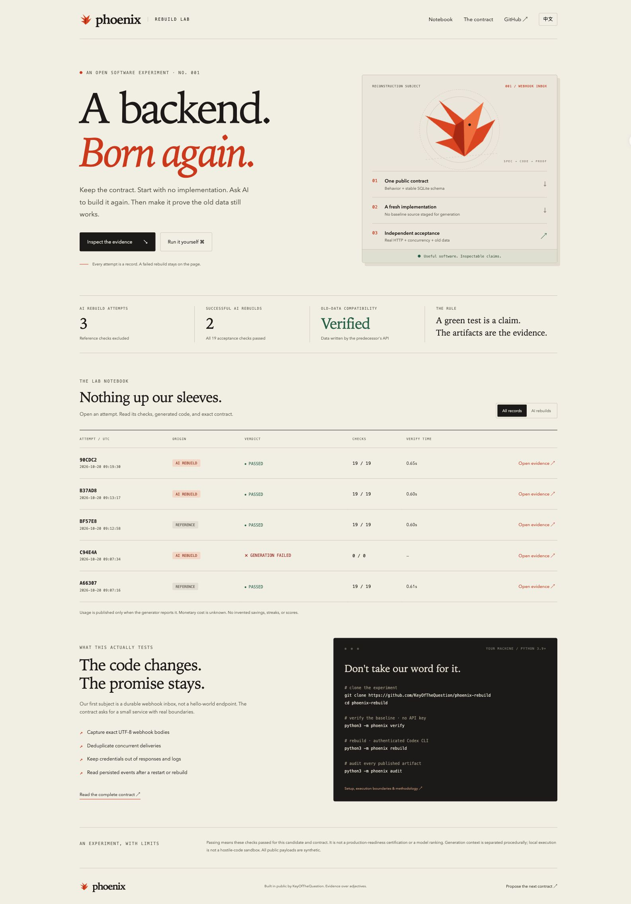

# Phoenix：同一份规格，重新诞生

**能否让 AI 从零重建同一个后端，并继续读取上一实现留下的数据？**

[公开实验记录](https://keyofthequestion.github.io/phoenix-rebuild/) · [English](README.md) · [完整规格](specs/webhook-inbox.md) · [实验方法](docs/methodology.md)

Phoenix 把这个问题做成可运行、可复现的公开实验：每次生成从新目录开始，AI 接收公开规格，生成完整代码，再由独立程序通过真实 HTTP 请求验收。每次发布保留源码、规格、验收结果、文件指纹和工具实际返回的用量。失败记录同样公开。

第一个重建对象是一个**持久化 Webhook 收件服务**。它要保存原始正文、保护管理接口、处理并发重复投递、避免凭据泄露，并兼容已有 SQLite 数据。当前规格有 19 项验收。人工审阅的参考实现与 AI 重建会明确区分。

## 立即运行

需要 Python 3.9+ 和 Git；参考实现及验收程序没有第三方运行依赖。

```sh
git clone https://github.com/KeyOfTheQuestion/phoenix-rebuild.git
cd phoenix-rebuild
python3 -m phoenix verify
python3 -m phoenix audit
python3 -m phoenix serve
```

打开 `http://127.0.0.1:8788` 查看本地实验记录簿。网页支持中英文、记录筛选和证据检查。

## 真正进行一次 AI 重建

先安装并登录 Codex CLI，再执行：

```sh
python3 -m phoenix rebuild --attempts 2 --timeout 300
# 指定一份可信的历史 AI 实现，验证跨实现的数据兼容：
python3 -m phoenix rebuild --predecessor docs/evidence/记录编号/server.py
```

这会使用你的 CLI 登录态和用量额度，进行真实的模型调用。默认不加载个人 CLI 配置和其中的 MCP 服务，避免个人设置干扰实验；身份认证保持可用。可以使用 `--model` 指定你有权限使用的模型，或使用 `--use-user-config` 主动加载个人设置。

生成目录里不放参考源码、历史实现或验收程序。失败重试只获得失败摘要。生成器不会删除仓库源码；运行记录写入 `docs/evidence/` 后才清理临时目录。

## 旧数据兼容如何验证

当前验收先启动上一实现，通过 HTTP 创建收件箱并写入一条事件，再停止它，让新代码打开同一个数据库。新实现需要读取旧事件，且相同幂等键不能生成第二条记录。早期记录使用验收程序插入的 v1 数据结构测试样本，具体以记录及归档验收器为准。

```sh
python3 -m phoenix replay <记录编号>
```

复验会先核对公开记录、文件清单和文件指纹，再用校验过的源码临时副本运行候选实现、验收器和上一实现（若有）。证据不一致或生成失败的记录会在加载归档代码前被拒绝，退出码为 2。复验不修改证据目录，也不调用模型。详见[复验完整性修复与验证记录](docs/maintenance/2026-10-21-replay-integrity.md)。

## 可选的容器验收

使用支持 Linux cgroup v2 的 Docker 引擎时，执行 `python3 -m phoenix container-verify`，可在一次性容器中运行同一套 HTTP 验收。外部网络关闭，根文件系统和输入只读，不透传主机凭据，并限制 CPU、内存与进程数。验收报告必须通过实际边界探测；镜像使用固定摘要，运行环境不可用时会报错，不自动退回主机执行。

这是单独输出验证 JSON 的命令；每日重建与历史复验仍使用本地执行，保留原有证据含义。详见[容器配置、限制与安装说明](docs/container-runner.md)及 [2026-10-23 验证记录](docs/maintenance/2026-10-23-container-runner.md)。

## 浏览器端验证记录页

可选的开发检查使用 Python 3.10+、固定版本的 Playwright 和无界面的 Chromium，在与 Pages 类似的项目子路径下操作真实网页，验证统计、记录筛选、语言偏好持久化、每条证据弹窗及链接、规格页导航，以及加载失败后的恢复。这些检查会在 CI 和 Pages 发布前执行；后端仍支持 Python 3.9+，没有新增运行依赖。

详见[浏览器测试安装说明](docs/setup.md#notebook-browser-checks)与 [2026-10-22 检查及重建记录](docs/maintenance/2026-10-22-notebook-browser-checks.md)。

## 记录的含义和边界

- `reference-verification`：参考实现的验证，不算 AI 重建成功。
- `ai-rebuild`：实际模型生成尝试，包括生成失败和验收失败。
- 不编造 Token 数、费用、节省比例、连续成功天数或人工修改次数。
- 默认重建与历史复验使用本地子进程；可选容器验收也不宣称能安全执行任意恶意代码。
- 上下文通过临时目录与提示要求分开，不宣称对抗恶意 Agent 的强隔离。
- 文件哈希用来检查产物是否一致，不是第三方认证。
- 通过当前验收不等于适合生产，更不等于通用模型能力排名。
- 公开请求数据均为合成示例。不要把真实业务凭据或客户数据上传到记录中。

欢迎通过 [Issue](https://github.com/KeyOfTheQuestion/phoenix-rebuild/issues/new?template=contract-change.yml) 提出下一轮需求，附上可观察的行为与验收例子。项目由 [KeyOfTheQuestion](https://github.com/KeyOfTheQuestion) 公开构建，采用 MIT 协议。

<details><summary>查看实验记录簿预览</summary>

[](https://keyofthequestion.github.io/phoenix-rebuild/)

</details>
