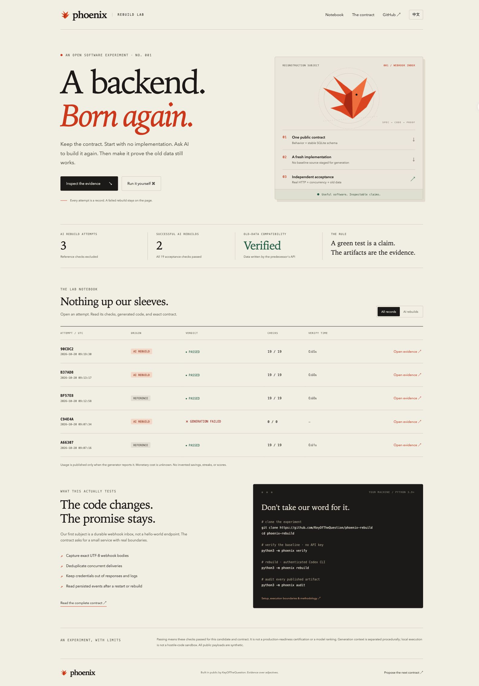

# Phoenix：同一份规格，重新诞生

**能否让 AI 从零重建同一个后端，并继续读取上一实现留下的数据？**

[公开实验记录](https://keyofthequestion.github.io/phoenix-rebuild/) · [English](README.md) · [完整规格](specs/webhook-inbox.md) · [实验方法](docs/methodology.md)

Phoenix 把这个问题做成可运行、可复现的公开实验：每次生成从新目录开始，AI 接收公开规格，生成完整代码，再由独立程序通过真实 HTTP 请求验收。每次发布保留源码、规格、验收结果、文件指纹和工具实际返回的用量。失败记录同样公开。

第一个重建对象是一个**持久化 Webhook 收件服务**。它要保存原始正文、保护管理接口、处理并发重复投递、避免凭据泄露，并兼容已有 SQLite 数据。契约 001 有 19 项验收；契约 002 加入迁移与保留期限，共 32 项。人工审阅的参考实现与 AI 重建会明确区分。

## 立即运行

需要 Python 3.9+ 和 Git；参考实现及验收程序没有第三方运行依赖。

```sh
git clone https://github.com/KeyOfTheQuestion/phoenix-rebuild.git
cd phoenix-rebuild
python3 -m phoenix verify
python3 -m phoenix audit
python3 -m phoenix serve
```

打开 `http://127.0.0.1:8788` 查看本地实验记录簿。网页支持中英文、记录筛选和证据检查。

## 真正进行一次 AI 重建

先安装并登录 Codex CLI，再执行：

```sh
python3 -m phoenix rebuild --attempts 2 --timeout 300
# 指定一份可信的历史 AI 实现，验证跨实现的数据兼容：
python3 -m phoenix rebuild --predecessor docs/evidence/记录编号/server.py
# 可选：主机 CLI 生成代码，随后在 Docker 中验收：
python3 -m phoenix rebuild --container --verification-timeout 90
```

这会使用你的 CLI 登录态和用量额度，进行真实的模型调用。默认不加载个人 CLI 配置和其中的 MCP 服务，避免个人设置干扰实验；身份认证保持可用。可以使用 `--model` 指定你有权限使用的模型，或使用 `--use-user-config` 主动加载个人设置。

生成目录里不放参考源码、历史实现或验收程序。失败重试只获得失败摘要。生成器不会删除仓库源码；运行记录写入 `docs/evidence/` 后才清理临时目录。

## 旧数据兼容如何验证

当前验收先启动上一实现，通过 HTTP 创建收件箱并写入一条事件，再停止它，让新代码打开同一个数据库。新实现需要读取旧事件，且相同幂等键不能生成第二条记录。早期记录使用验收程序插入的 v1 数据结构测试样本，具体以记录及归档验收器为准。

```sh
python3 -m phoenix replay <记录编号>
python3 -m phoenix replay <记录编号> --container --timeout 90
```

复验会先核对公开记录、文件清单和文件指纹，再用校验过的源码临时副本运行候选实现、验收器和上一实现（若有）。证据不一致或生成失败的记录会在加载归档代码前被拒绝，退出码为 2。复验不修改证据目录，也不调用模型。详见[复验完整性修复与验证记录](docs/maintenance/2026-10-21-replay-integrity.md)。

## 可选的容器验收

使用支持 Linux cgroup v2 的 Docker 引擎时，执行 `python3 -m phoenix container-verify`，可在一次性容器中运行同一套 HTTP 验收。外部网络关闭，根文件系统和输入只读，不透传主机凭据，并限制 CPU、内存与进程数。验收报告必须通过实际边界探测；镜像使用固定摘要，运行环境不可用时会报错，不自动退回主机执行。

`container-verify` 使用当前验收器。复验历史实验时，可用 `replay 记录编号 --container`：先校验证据包，再把校验过的候选源码、归档验收器和已记录的上一实现源码字节交给 Docker，不在主机加载归档验收器。没有记录上一实现的早期实验会保留原来的 SQL 测试样本。这些验证命令不改写历史结果，也不调用模型。

`rebuild --container` 会通过主机 CLI 真实调用模型，再把生成源码与生成前冻结的验收器、上一实现交给 Docker 验收。调用模型前先检查 Docker 和固定镜像；若生成后运行环境出错，会以 `verification-error` 保留生成源码，不产生验收结论、不退回主机执行，也不再生成重试，退出码为 2。`--timeout` 仍限制生成耗时，`--verification-timeout` 单独限制容器执行。默认仍为本地执行；本机没有 Docker，因此定时重建仍使用本地模式。

详见[容器配置、限制与安装说明](docs/container-runner.md)及 [2026-10-26 容器重建验证记录](docs/maintenance/2026-10-26-container-rebuild.md)。

## 重建保留期限与 v1 数据迁移功能

[第二份契约](specs/webhook-inbox-retention.md)增加按收件箱配置保留期限、每批最多删除 100 条过期事件，以及从 v1 原子迁移。迁移保留旧事件、令牌和幂等状态，默认不开启清理。[AI 辅助开发的参考试验](examples/retention/server.py)保留原有表结构，只新增策略表；读取或修改策略不自动删除事件。

```sh
python3 -m phoenix verify-retention
python3 -m phoenix verify-retention --full
python3 -m phoenix verify-retention --full --publish
# 从可信的历史 v1 AI 实现创建数据后验证迁移：
python3 -m phoenix verify-retention --predecessor docs/evidence/记录编号/server.py
# 生成契约 002 并运行全部 32 项验收；选择成功的 v1 AI 实现作为上一版：
python3 -m phoenix rebuild --contract 002 --attempts 2 --timeout 300 \
  --predecessor docs/evidence/20261103T023452Z-4ec8a9/server.py
# 可选：先预检 Docker，再将生成的 v2 实现在容器内验收：
python3 -m phoenix rebuild --contract 002 --container --verification-timeout 90 \
  --predecessor docs/evidence/20261103T023452Z-4ec8a9/server.py
```

默认的 13 项试验检查真实的上一实现 HTTP 数据、迁移、策略持久化、限量及并发清理、收件箱隔离和幂等键重用。完成迁移验证后，验收器仅通过 SQLite 回填合成 v2 事件的时间，用于确定性测试，不声称真实等待过保留期限。

`--full` 再加入原有 19 项后端 HTTP 检查，并明确要求健康接口返回结构版本 2，合计 32 项。两个阶段使用一次性捕获的同一份候选及上一实现源码，测试数据库各自独立。报告保留分阶段结果，拒绝缺少检查的“通过”结果或变化的源码绑定。v1 默认仍要求结构版本 1，保留原有 19 个检查编号；验收器源码变化详见 [2026-10-28 验证及反向测试](docs/maintenance/2026-10-28-retention-composed.md)。

不加 `--publish` 时只输出结果。`--full --publish` 会在验收前捕获候选源码、上一实现、契约、入口及四个项目模块依赖，再把同一份字节发布为**契约 002 的参考验证**。使用 `python3 -m phoenix replay 记录编号` 时，会先核对完整证据包，再在临时私有包中运行归档模块，不导入当前工作区验收器，也不修改归档。加上 `--container --timeout 90`，可将完整的已校验证据包交给同一套受限 Docker 配置运行。主机会核对八项源码／契约指纹、32 项验收结果和实际边界探测；Docker 不可用或输出不合法时退出码为 2，不回退到主机执行。详见 [2026-10-30 容器复验检查](docs/maintenance/2026-10-30-retention-container.md)。

`rebuild --contract 002` 现在会真实调用模型，使用完整冻结的 32 项验收包，并以独立的 `retention-ai-v1` 配置归档准确提示词与全部依赖。参考验证不调用模型，仍使用 `retention-composed-v1`，不计入 AI 指标。默认生成仍是契约 001。审计严格核对各配置的记录类别、完整产物、源码绑定和检查集合；历史记录保持不变。

`rebuild --contract 002 --container` 现在会在调用模型前预检 Docker，生成结束后在容器内运行完整冻结的 AI 验收包，不在主机加载归档验收代码。若容器运行或报告校验出错，会保留全部十项产物，以零检查的 `verification-error` 记录并停止，不回退主机，也不再次调用模型。默认仍是本地验收；已完成的 AI 归档也支持本地、Docker 和多运行时矩阵复验。详见[容器生成接入与验证](docs/maintenance/2026-11-05-retention-container-rebuild.md)。

32 项迁移验收仍要求 v1 上一实现。新增的独立 8 项检查用于验证 v2→v2 的策略与数据延续，不改变重建验收结论，也不新增 AI 尝试。生成失败会保留完整的零检查证据包。[首个真实 32/32 AI 重建与双运行时复验](docs/maintenance/2026-11-04-retention-ai.md)的历史记录及当时的方法边界保持不变。

```sh
python3 -m phoenix verify-continuity --candidate path/to/trusted/v2.py \
  --predecessor path/to/trusted/previous-v2.py --output-dir path/to/new-continuity-bundle
python3 -m phoenix replay-continuity path/to/new-continuity-bundle
```

延续性测试先通过 HTTP 在 v2 上一实现中创建数据，再检查启用、明确禁用及较长保留期限的策略，切换实现和重启后的正文、请求头、时间戳、令牌及幂等状态，以及显式限量清理和过期键重用。仅在停止服务时通过 SQLite 回填合成测试事件的时间，不声称真实等待过保留期限。两个命令都在本地执行可信代码，不调用模型。可选的 `--output-dir` 会将候选、上一实现、契约、验收器及 HTTP 辅助模块这五份冻结输入，连同报告和文件清单保存到新目录，不写入 AI 记录。复验先核对文件指纹、类别／配置及源码绑定，再执行临时副本。详见[测试样本、证据与边界](docs/maintenance/2026-11-06-v2-continuity.md)。

运行时会影响结果：10 月 30 日的 AI 候选在 Python 3.14 上通过 19/19，但在 Python 3.9 的补充复验中，因空查询字符串的解析差异失败了 2 项。两次实际观察及未经修改的候选源码均保留在[跨版本失败记录](docs/maintenance/2026-10-30-retention-container.md#cross-runtime-failure-discovered-by-ci)中。一次归档通过不代表已覆盖所有受支持的 Python 版本。

新的验收与复验结果包含 `execution_runtime`，记录实际 Python 实现／版本和 SQLite 库版本。网页显示这些版本；旧报告缺少信息时明确显示“未记录”。复验测量本次运行时，保留原始报告。要检查 Python 最低支持版本，可用已安装的 Python 3.9 解释器执行完整命令，例如 `python3.9 -m phoenix rebuild --attempts 2 --timeout 300`。候选及上一实现使用同一解释器；Codex CLI 的默认模型策略不变。详见[运行时证据及范围](docs/maintenance/2026-11-02-runtime-evidence.md)。

在 POSIX 系统上，可用多个已安装的 Python 比较同一份冻结归档：

```sh
python3 -m phoenix replay-matrix 记录编号 --python python3.9 --python python3.14 --timeout 30
```

命令只审计一次，再把同一份已捕获字节交给各运行时。可明确指定 1..4 个解释器，每个限时 1..300 秒；超时会清理本次进程组。输出各自的实际版本和新验收报告，保留失败，不安装 Python、不调用模型，也不新增公开尝试记录。退出码 0 表示全部运行通过，1 表示验收失败，2 表示拒绝执行或运行时／报告错误；解释器缺失时不自动替换。这仍是本地执行可信代码，不是恶意代码沙箱，也不代表完整版本覆盖。详见[矩阵复验及反向验证](docs/maintenance/2026-11-03-runtime-matrix.md)。


## 本机 Webhook 投递试验

读取已有事件，并将原始 UTF-8 正文发送给明确指定的本机 HTTP 接收器：

```sh
python3 -m phoenix deliver-event --source http://127.0.0.1:8787 \
  --event-id EVENT_ID --destination http://127.0.0.1:9000/webhook --timeout 3
```

通过 `PHOENIX_ADMIN_TOKEN` 环境变量提供收件服务的管理令牌。客户端校验
正文指纹、转发指定事件头，每次最多尝试一次 POST，并限制整个工作进程的
耗时和响应读取量。POST 开始后无法确认响应时，回执为 `delivery-unknown`。
当前试验接受 IPv4 回环 HTTP 地址。详见[使用方法](docs/delivery.md)及
[独立接收器验证](docs/maintenance/2026-11-07-loopback-delivery.md)。

加上 `--journal ./deliveries.sqlite3`，可在联网前保存本次调用；使用
`python3 -m phoenix delivery-history --journal ./deliveries.sqlite3 --limit 20`
查看历史。中断记录保留为 `unconfirmed`，查询不会重新发送。日志只保存事件
ID、指纹和过滤后的回执，不保存令牌、URL 或正文。目前是投递记录，持久队列
仍待后续实现；详见 [21 项投递与日志检查](docs/maintenance/2026-11-08-delivery-journal.md)。
若最终写入失败，终端回执保留 HTTP 结果，并返回 `journal_saved: false` 和退出码 2；
这不代表接收器未收到事件。

需要明确的接收地址清单时，加上 `--destination-policy .phoenix/destinations.json`。
[清单格式](docs/delivery.md#optional-destination-policy)允许 1..16 个完整本机 URL，
端口、路径和查询必须逐字匹配；格式错误或地址不匹配时，在联网及创建日志前拒绝。
最终回执保存所读文件的 SHA-256。[策略检查记录](docs/maintenance/2026-11-09-destination-policy.md)
包括真实 AI 收件服务经清单批准后的投递。该选项按调用启用，不开放外网地址。

历史查询现在返回 `next_cursor`。非空时，将它传给
`delivery-history --journal ./deliveries.sqlite3 --limit 20 --cursor TOKEN`
继续读取更早的记录，可浏览首批 100 条之后的历史。分页只读，按开始时间和 ID
排序，较新记录插入不会挤动后续页；回执仍可能在翻页期间完成。这是继续读取的
位置，不是事务快照。详见 [38 项检查与方法边界](docs/maintenance/2026-11-10-history-pagination.md)。

## 浏览器端验证记录页

可选的开发检查使用 Python 3.10+、固定版本的 Playwright 和无界面的 Chromium，在与 Pages 类似的项目子路径下操作真实网页，验证统计、记录筛选、语言偏好持久化、每条证据弹窗及链接、规格页导航，以及加载失败后的恢复。这些检查会在 CI 和 Pages 发布前执行；后端仍支持 Python 3.9+，没有新增运行依赖。

详见[浏览器测试安装说明](docs/setup.md#notebook-browser-checks)与 [2026-10-22 检查及重建记录](docs/maintenance/2026-10-22-notebook-browser-checks.md)。

## 记录的含义和边界

- `reference-verification`：参考实现的验证，不算 AI 重建成功。
- `ai-rebuild`：实际模型生成尝试，包括生成失败和验收失败。
- 不编造 Token 数、费用、节省比例、连续成功天数或人工修改次数。
- 默认重建及未启用 `--container` 的复验使用本地子进程；可选容器验收也不宣称能安全执行任意恶意代码。
- 上下文通过临时目录与提示要求分开，不宣称对抗恶意 Agent 的强隔离。
- 文件哈希用来检查产物是否一致，不是第三方认证。
- 通过当前验收不等于适合生产，更不等于通用模型能力排名。
- 公开请求数据均为合成示例。不要把真实业务凭据或客户数据上传到记录中。

欢迎通过 [Issue](https://github.com/KeyOfTheQuestion/phoenix-rebuild/issues/new?template=contract-change.yml) 提出下一轮需求，附上可观察的行为与验收例子。项目由 [KeyOfTheQuestion](https://github.com/KeyOfTheQuestion) 公开构建，采用 MIT 协议。

<details><summary>查看实验记录簿预览</summary>

[](https://keyofthequestion.github.io/phoenix-rebuild/)

</details>
